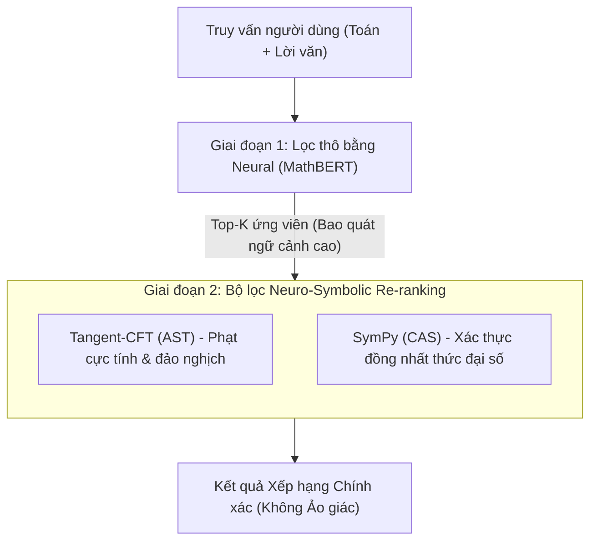

# BÁO CÁO THỰC NGHIỆM ĐÁNH GIÁ CÁC MÔ HÌNH CƠ SỞ (BASELINES) TRONG HỆ THỐNG MATHIR

> **Học phần:** SC203 - Phương pháp Nghiên cứu Khoa học  
> **Chương trình:** Tiên tiến Khoa học Máy tính (APCS) - Trường Đại học Khoa học Tự nhiên, ĐHQG-HCM  
> **Giảng viên hướng dẫn:** PGS. TS. Trần Minh Triết | **Cán bộ giám sát:** Thầy Huỳnh Viết Thám  
> **Nhóm thực hiện (Nhóm 2):**  
> - Đỗ Viết Hoàng Long (Nhóm trưởng - MSSV: 25125024)  
> - Trần Đức Toàn (MSSV: 25125091)  
> - Phạm Trung Duy (MSSV: 25125010)  
> - Nguyễn Nguyễn Gia Bảo (MSSV: 25125006)  
>
> **Mã nguồn & Thực nghiệm:** [GitHub - MathIR Repository](https://github.com/Dvhlong55/MathIR)

---

## 1. ĐẶT VẤN ĐỀ & MỤC TIÊU THỰC NGHIỆM

Trong bài toán **Truy vấn Thông tin Toán học (Mathematical Information Retrieval - MathIR)**, việc biểu diễn và so khớp độ tương đồng ngữ nghĩa giữa các công thức toán học và ngữ cảnh văn bản là một thách thức lớn. Các phương pháp tiếp cận hiện nay thường chia thành hai trường phái:
1. **Trường phái Hình thức / Cấu trúc (Symbolic & Tree-based):** Sử dụng Đại số máy tính (CAS - SymPy) hoặc Cây cú pháp toán học (Operator Tree / AST trong Tangent-CFT).
2. **Trường phái Học sâu (Neural / Pre-trained Transformers):** Sử dụng các mô hình ngôn ngữ lớn được tiền huấn luyện chuyên sâu trên dữ liệu toán học (MathBERT).

Báo cáo này trình bày kết quả **thực nghiệm kiểm thử đối kháng (Stress Testing / Adversarial Evaluation)** trên 3 mô hình cơ sở nhằm:
- Phân tích sâu các **nút thắt và ảo giác ngữ nghĩa (Failure Modes)** của mạng nơ-ron **MathBERT** (trọng tâm chính).
- Ghi nhận ngắn gọn các hạn chế cố hữu của **Tangent-CFT** và **SymPy CAS**.
- Đề xuất kiến trúc **Mô hình Lai Đa Tầng (Multi-Stage Neuro-Symbolic Hybrid)** kết hợp cả 3 phương pháp để giải quyết triệt để các điểm nghẽn.

---

## 2. THIẾT LẬP MÔI TRƯỜNG THỰC NGHIỆM

Hệ thống benchmark được xây dựng và chạy trực tiếp trên môi trường cục bộ:
- **MathBERT Baseline:** Checkpoint gốc 110 triệu tham số (12-layer Transformer, 768-hidden dimension) từ repo chính thức của Peng et al. (2021) ([tbs17/MathBERT](https://github.com/tbs17/MathBERT)). Độ tương đồng được đo bằng **Cosine Similarity** giữa các vector biểu diễn dense embedding.
- **Tangent-CFT AST Baseline:** Trích xuất cây toán tử OPT/AST và tính tỷ lệ trùng lặp bộ ba quan hệ `(Toán tử, Toán hạng, Vị trí)` (Mansouri et al., SIGIR 2019).
- **SymPy CAS Baseline:** Rút gọn hiệu số đại số $\Delta = f_A - f_B$ nhằm kiểm định đồng nhất thức ($\Delta = 0$).

---

## 3. KẾT QUẢ ĐÁNH GIÁ TRỌNG TÂM: MẠNG NƠ-RON MATHBERT

Mặc dù MathBERT là mô hình Transformer hiện đại được tiền huấn luyện trên hàng trăm nghìn bài báo arXiv, các kết quả thực nghiệm chỉ ra rằng mô hình này mắc phải các **sai lầm ngữ nghĩa nghiêm trọng** khi áp dụng vào truy vấn toán học.

### 3.1. Ảo giác cực tính & Hướng bất đẳng thức (Polarity Inversion Blindness)

Mạng nơ-ron MathBERT biểu diễn công thức theo cơ chế tự chú ý (Self-Attention) trên các subword token. Khi hai biểu thức chỉ khác nhau ở dấu bất đẳng thức ($>$ và $<$), ngữ cảnh từ vựng xung quanh hoàn toàn trùng khớp, khiến vector embedding bị kéo lại gần nhau:

| Biểu thức A | Biểu thức B | Độ tương đồng MathBERT | Bản chất toán học |
| :--- | :--- | :---: | :--- |
| `x > 0` | `x < 0` | **93.0%** | **Trái ngược hoàn toàn** (Miền dương vs Miền âm) |

> [!WARNING]
> **Hệ quả trong Search Engine:** Một người dùng tìm kiếm bài toán với điều kiện số dương ($x > 0$) sẽ bị MathBERT xếp hạng cao các tài liệu chứa điều kiện số âm ($x < 0$), gây sai lệch hoàn toàn kết quả giải toán.

---

### 3.2. Ảo giác đảo nghịch phân số (Fraction Inversion)

Khi đổi chỗ tử số và mẫu số, thứ tự vị trí toán hạng trong cây 2D bị đảo lộn hoàn toàn ($x/y$ khác biệt với $y/x$). Tuy nhiên, MathBERT chấm độ tương đồng gần như tuyệt đối:

| Biểu thức A | Biểu thức B | Độ tương đồng MathBERT | Bản chất toán học |
| :--- | :--- | :---: | :--- |
| `\frac{x}{y}` | `\frac{y}{x}` | **99.0%** | **Nghịch đảo** ($f_A = \frac{1}{f_B}$) |

MathBERT đạt điểm số **99.0%** vì cả hai công thức đều chứa cùng một tập token `['x', 'y', '\frac']`. Cơ chế positional encoding 1D tuyến tính không đủ năng lực nắm bắt vai trò phân cấp cấu trúc tử/mẫu 2D.

---

### 3.3. Ảo giác dấu số mũ (Exponent Sign Disparity)

Tương tự phân số, hai hàm số có đồ thị và tính chất đơn điệu đối nghịch nhau hoàn toàn ($e^x$ đồng biến tăng nhanh, $e^{-x}$ nghịch biến tiệm cận 0) vẫn bị MathBERT nhận định là gần như giống nhau:

| Biểu thức A | Biểu thức B | Độ tương đồng MathBERT | Bản chất toán học |
| :--- | :--- | :---: | :--- |
| `e^x` | `e^{-x}` | **90.9%** | **Đối xứng qua trục tung** |

---

### 3.4. Nhầm lẫn sai lầm đại số cơ bản (Algebraic Misconception)

Một trong những sai lầm kinh điển của học sinh là đánh đồng bình phương của tổng với tổng các bình phương: $(a+b)^2 \neq a^2 + b^2$.

| Biểu thức A | Biểu thức B | Độ tương đồng MathBERT | Sai số đại số ($\Delta$) |
| :--- | :--- | :---: | :--- |
| `(a+b)^2` | `a^2 + b^2` | **93.4%** | Thiếu hạng tử giao chéo $2ab$ |

MathBERT không thực hiện suy diễn đại số mà chỉ dựa trên sự trùng lặp biểu tượng $a, b, 2, +$, dẫn đến việc chấm mức tương đồng nguy hiểm **93.4%**.

---

### 3.5. Rào cản đa ngữ chéo Anh – Việt (Cross-lingual Degradation)

MathBERT được huấn luyện đơn ngữ trên kho ngữ liệu arXiv (tiếng Anh). Khi đưa vào bài toán có lời văn bằng tiếng Việt, hiệu năng mô hình sụt giảm nghiêm trọng:

* **Trường hợp cùng nội dung tiếng Anh:**
  `Let $a \ge 2$. Find the minimum value of $P = a + \frac{1}{a}$.` vs `Given $a \ge 2$...`  
  $\rightarrow$ MathBERT đạt **93.1%**.
* **Trường hợp song ngữ Anh – Việt (Cùng chung bản chất toán học):**
  `Let $a \ge 2$...` vs `Cho $b \ge 2$. Tìm giá trị nhỏ nhất của $Q = b + \frac{1}{b}$`  
  $\rightarrow$ MathBERT rớt thê thảm xuống **56.8%**.

Khi bài toán tiếng Việt có công thức đại số tường minh (`Tìm tất cả $n$ để $a^2 - b^2$` vs `(a-b)(a+b)`), điểm MathBERT cũng chỉ đạt **54.9%** (trong khi CAS nhận diện chính xác 100% $\Delta = 0$):

> [!NOTE]
> **Nguyên nhân:** Tokenizer WordPiece của MathBERT không có vốn từ vựng (Vocabulary) tiếng Việt có dấu. Các từ tiếng Việt bị băm nhỏ thành vô số ký tự rác `[UNK]` hoặc subwords rời rạc, làm phá vỡ phân phối vector embedding.

---

## 4. TỔNG KẾT HẠN CHẾ CỦA 2 MÔ HÌNH CƠ SỞ CÒN LẠI

Hai mô hình còn lại không cần minh họa hình ảnh chi tiết vì các sai số và hạn chế mang tính cố hữu và hiển nhiên:

### 4.1. Tangent-CFT (Cây cú pháp toán học AST Tuples)
- **Cực kỳ cứng nhắc với phép đổi tên biến (Alpha-renaming):** Nếu thay biến $x$ thành biến $t$ (ví dụ $\int x^2 dx$ vs $\int t^2 dt$), các tuple quan hệ `(^, x, L)` và `(^, t, L)` hoàn toàn lệch nhau, khiến điểm tương đồng sụt giảm về 0%.
- **Bất lực trước biến đổi đại số tương đương:** Khi so sánh $a^2 - b^2$ với $(a-b)(a+b)$, cây cú pháp của hai vế hoàn toàn khác biệt về độ sâu và thứ tự toán tử $\rightarrow$ Điểm trùng lặp tuple AST chỉ đạt **25.0%**.

### 4.2. SymPy CAS (Hệ thống Đại số Hình thức)
- **Độ giòn cú pháp (Syntactic Fragility):** CAS chỉ chấp nhận các biểu thức đại số chuẩn tắc đóng kín. Khi gặp chuỗi số tự nhiên có ký hiệu dấu ba chấm không chính quy ($1 + 2 + \dots + n$), CAS báo lỗi cú pháp ngay lập tức và không thể xử lý.
- **Quá khắt khe trước biến ràng buộc (Domain Blindness):** Biểu thức $\sqrt{x^2}$ và $x$ bị CAS đánh giá là khác nhau ($\Delta = \sqrt{x^2} - x \neq 0$) do không có cơ chế tự suy luận ngữ cảnh ngầm định $x \ge 0$.

---

## 5. ĐỊNH HƯỚNG NGHIÊN CỨU: MÔ HÌNH HỢP NHẤT (HYBRID FUSION)

Từ những phát hiện thực nghiệm trên, nhóm đề xuất hướng đi cốt lõi cho đề tài: **Xây dựng kiến trúc mô hình lai đa tầng (Multi-Stage Neuro-Symbolic Hybrid Architecture)** nhằm lấy thế mạnh của mô hình này bù đắp cho lỗ hổng chí mạng của mô hình kia.

### Chiến lược kết hợp cụ thể:
1. **Tầng 1 (Coarse Candidate Retrieval - MathBERT):** Quét nhanh toàn bộ kho tài liệu ở tốc độ cao nhờ vector embedding, nắm bắt ngữ cảnh rộng và ngôn ngữ tự nhiên để chọn ra Top-50 tài liệu tiềm năng.
2. **Tầng 2 (Structural Penalty Filter - Tangent-CFT):** Trích xuất cấu trúc cây 2D của các ứng viên Top-50. Nếu phát hiện sai khác toán tử quan hệ ($>$ vs $<$) hoặc lộn ngược vị trí tử/mẫu phân số, áp dụng hệ số phạt nặng (Penalty) để triệt tiêu ảo giác điểm cao của MathBERT.
3. **Tầng 3 (Deterministic Algebraic Boost - SymPy CAS):** Chạy kiểm tra đồng nhất thức đại số. Nếu $\Delta = 0$, ưu tiên đẩy thẳng tài liệu lên vị trí Top-1 bất kể điểm số nơ-ron.
4. **Mở rộng Tiếng Việt (Vietnamese Context Alignment):** Bổ sung module chuẩn hóa và ánh xạ ngữ cảnh bài toán tiếng Việt sang biểu diễn toán học chuẩn trước khi đưa vào embedding.

---

## 6. KẾT LUẬN

Bộ thực nghiệm đã chứng minh rõ ràng: **Không một mô hình đơn lẻ nào hiện nay đủ khả năng giải quyết toàn diện bài toán MathIR**. 
* MathBERT mạnh về ngữ cảnh nhưng "mù" cực tính và yếu tiếng Việt.
* Tangent-CFT và CAS vững chắc về toán học nhưng quá cứng nhắc và dễ vỡ trước ngôn ngữ tự nhiên.

Hướng tiếp cận **Merge 3 mô hình (Tri-brid Neuro-Symbolic)** của Nhóm 2 là hoàn toàn có cơ sở khoa học vững chắc, giải quyết đúng khoảng trống nghiên cứu (Research Gap) và có tính ứng dụng thực tiễn cao cho học phần SC203.
